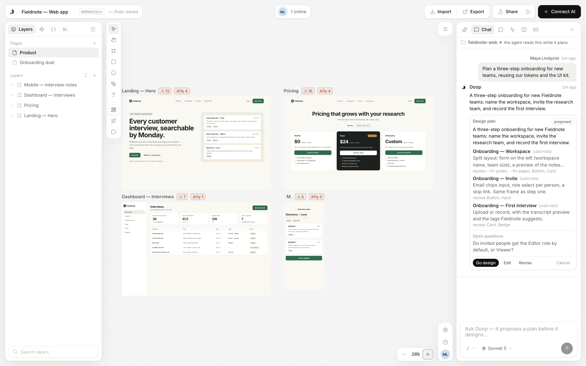
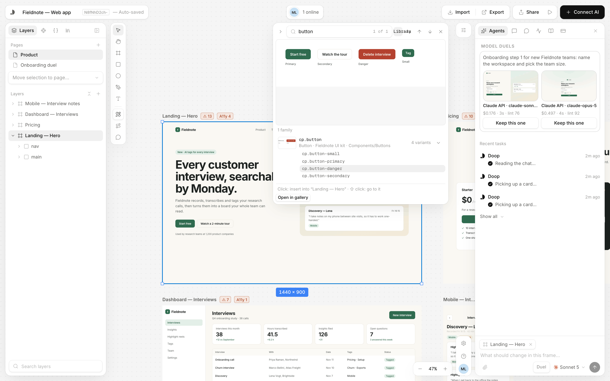
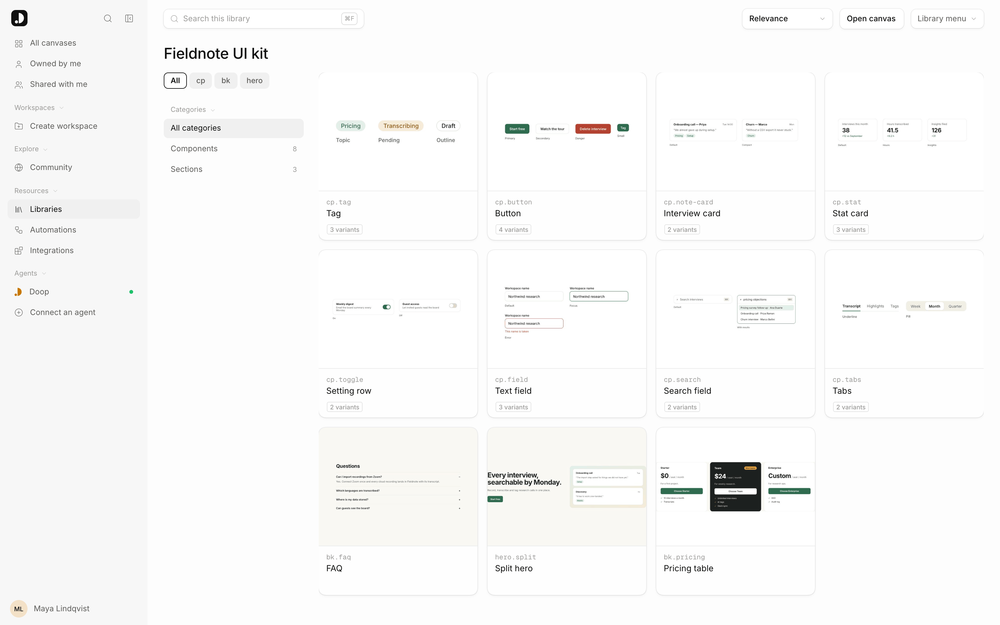
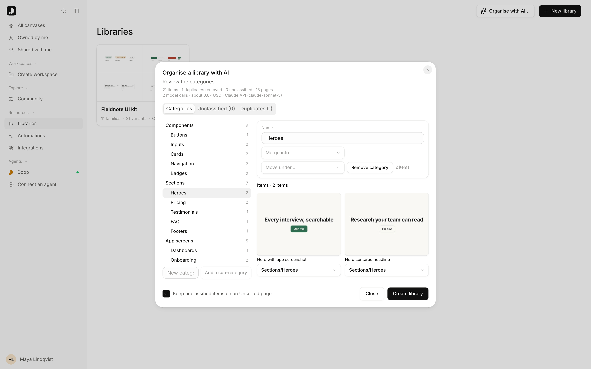
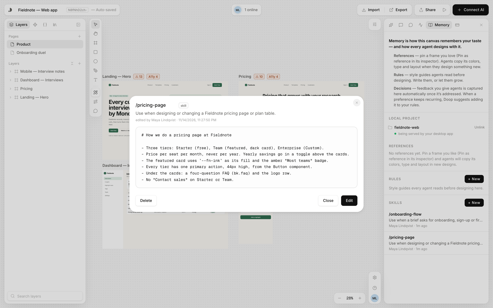
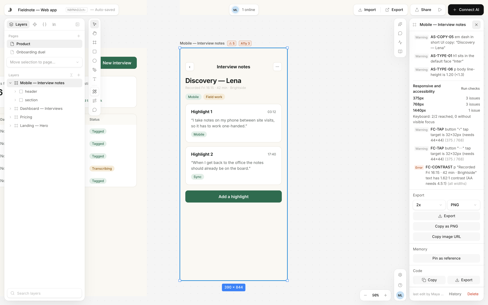
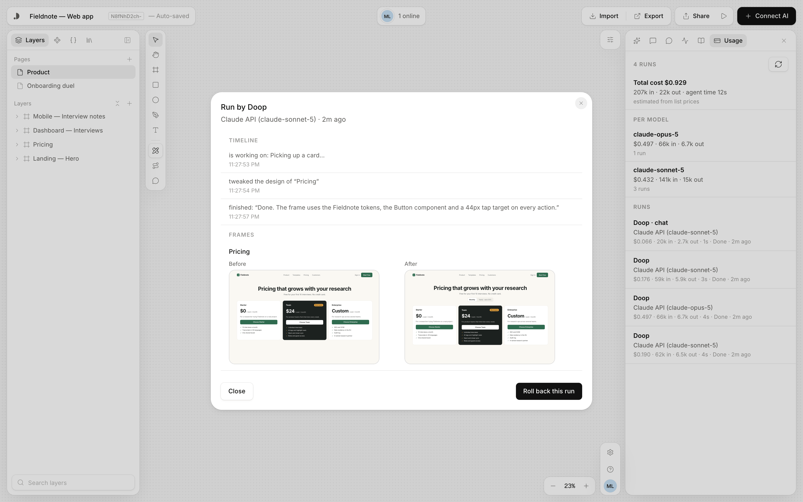
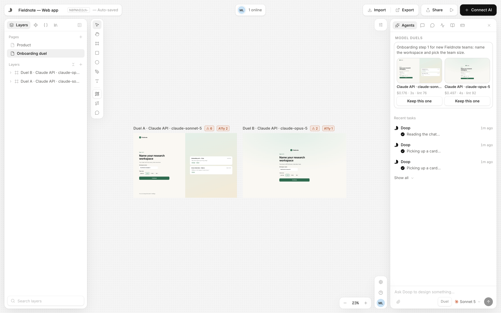
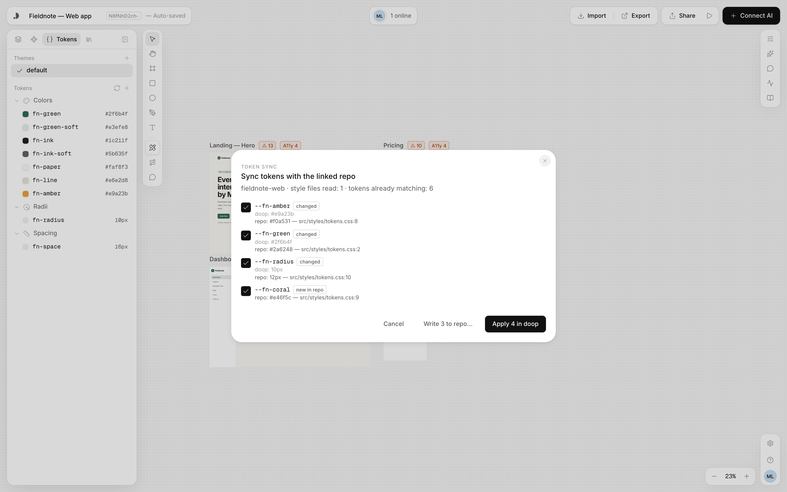
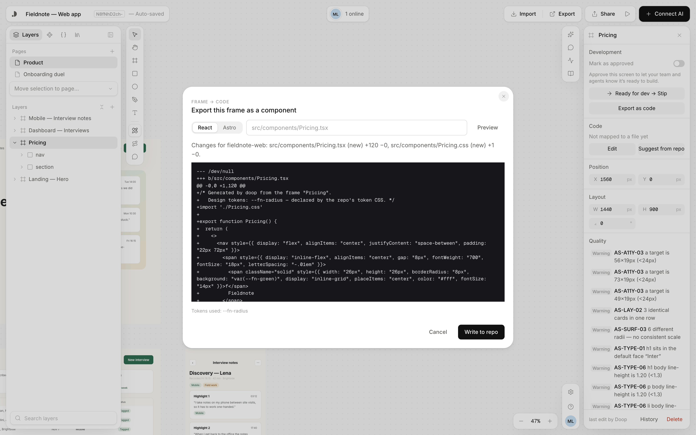

# redoop

A fork of doop for people who design and ship code with AI agents, on one canvas linked to their repo.
Status: alpha, updated 2026-11-14

<a href="LICENSE"></a>
<a href="https://github.com/kgoedecke/doop"></a>

## What it does

redoop starts from [doop](https://github.com/kgoedecke/doop), the open-source multiplayer design
canvas for humans and AI agents. doop gives you the canvas: frames that render real HTML, live
cursors, and an MCP server so agents design next to you. redoop adds what a builder needs when the
same agents also write the code: the repo, a design library, checks, and a record of what each
agent run did and cost.

- **Design next to your repo.** Link a canvas to a project folder. The agent reads it while it
  plans, and the Chat tab answers a brief with a plan you approve before anything is designed.
- **Build from a library.** Turn a canvas into a design library: frames become items with
  variants, categories and tags. ⌘F finds an item, previews it, and inserts a scoped copy into the
  selected frame. Agents search the same index.
- **Sort old kits with AI.** Pick several canvases. A model on your own account folds the
  duplicates, proposes one category tree and files every item. You review the tree before a new
  library is made. The source canvases are not changed.
- **Teach the agent your rules.** Canvas skills are named notes such as "how we do a pricing page".
  Agents see each skill's one-line description and load the one that fits.
- **Check every frame.** The server lays each frame out at 375, 768 and 1440px and walks it with
  the keyboard: overflow, small tap targets, text contrast, focus. An anti-slop lint runs too.
- **See what each run did.** Every agent run records its tokens, time and cost. Open a run to see
  each frame before and after, and roll the whole run back in one step.
- **Compare models.** A duel sends one brief to two or three models, each into its own frame, and
  shows cost, time and lint score side by side. You keep one.
- **Use the agent CLIs you already pay for.** In the desktop app, Devin and Grok run on your own
  login, next to the Claude Plan, through the Agent Client Protocol.
- **Keep tokens and code in sync.** The Tokens panel diffs the canvas's tokens with the repo's CSS
  variables. A frame exports as a React or Astro component, shown as a patch before it is written.
- **Run it yourself.** One command on a Mac, or your own server. Canvases, uploads and keys stay
  on your machine.

<table>
  <tr>
    <td width="50%"><br><sub>Chat: a brief, then a plan to approve.</sub></td>
    <td width="50%"><br><sub>⌘F: find a library item and insert it.</sub></td>
  </tr>
  <tr>
    <td><br><sub>A library's gallery.</sub></td>
    <td><br><sub>Organise with AI: review the tree.</sub></td>
  </tr>
  <tr>
    <td><br><sub>Canvas skills in the Memory panel.</sub></td>
    <td><br><sub>Frame checks in the Inspector.</sub></td>
  </tr>
  <tr>
    <td><br><sub>Usage and run replay.</sub></td>
    <td><br><sub>A model duel.</sub></td>
  </tr>
  <tr>
    <td><br><sub>Token sync with the repo.</sub></td>
    <td><br><sub>Frame to code.</sub></td>
  </tr>
</table>

The screenshots use an invented product ("Fieldnote") seeded by `scripts/seed-demo.ts` and taken
by `scripts/readme-shots.ts`; the agent in them is a local stand-in, not a real model. Every
feature this fork adds, and the upstream pull requests it merged early, are listed in
[docs/FEATURES.md](docs/FEATURES.md).

## Requirements

- **Local install:** a Mac with Apple silicon, macOS 26 and Apple's
  [`container`](https://github.com/apple/container/releases/latest) 1.0 or later.
- **Hosted install:** Docker, or a Kubernetes cluster. Postgres 16 is optional: without
  `DATABASE_URL` the server uses an embedded Postgres (PGlite) in its data folder.
- **From source:** Bun 1.3.10 (pinned in `package.json`) and Node.js.
- **Model account:** the built-in agent runs on an account you connect (a Claude, OpenAI, Gemini
  or OpenRouter key, or a ChatGPT subscription). Agents you bring over MCP need none.
- **Desktop-only features** (reading a local project folder, live frames on `localhost`, writing
  a patch into your repo) need the doop desktop app.

## Install

### Local (Mac)

```sh
curl -fsSL https://raw.githubusercontent.com/BRYANN2K/redoop/main/scripts/install-local.sh | sh
```

One container on `127.0.0.1:4400`, with the database and uploads in `~/.doop/data` and secrets
generated on your Mac. Run it again to update. `~/.doop/bin/doop-local` starts, stops, updates or
uninstalls it. The script, step by step:
[.context/RELEASE.md](.context/RELEASE.md#local-install-on-a-mac-apple-container-this-fork).

### Hosted

The image is built from `main` for amd64 and arm64: `ghcr.io/bryann2k/redoop:main` (also
`:latest` and `:sha-<commit>`).

```sh
docker run -d --name redoop -p 4400:4400 -v redoop-data:/app/data \
  -e BETTER_AUTH_SECRET="$(openssl rand -hex 32)" \
  -e SECRETS_ENCRYPTION_KEYS="main:$(openssl rand -base64 32)" \
  -e BETTER_AUTH_URL=http://localhost:4400 \
  ghcr.io/bryann2k/redoop:latest
```

Keep the two secrets: a new `SECRETS_ENCRYPTION_KEYS` cannot read the keys stored with the old
one. With Postgres, `BETTER_AUTH_SECRET=$(openssl rand -hex 32) docker compose up -d` builds the
image from source and starts both. This
fork's own instance runs on k3s behind Tailscale: manifests in `deploy/k3s/`, steps in
[FORK.md](FORK.md). Every environment variable: [docs/doop-reference.md](docs/doop-reference.md#deploy).

### From source

```sh
git clone https://github.com/BRYANN2K/redoop && cd redoop
bun install
bun run dev   # web app on :4300, server on :4400, embedded Postgres
```

## Usage

Open `http://localhost:4400` (`:4300` from source), create an account and a canvas. Then connect
your coding agent:

```sh
claude mcp add --transport http redoop http://localhost:4400/mcp
# a browser window asks you to approve; the agent then works as you
```

Ask it to design on your canvas and watch the frames stream in. Codex, Cursor, OpenCode and any
other MCP client connect the same way. Headless agents use an agent key from Settings → Agent keys.

From a terminal, the `doop` CLI links a project folder to a canvas, finds frames and pulls or
pushes them as HTML files: [docs/cli.md](docs/cli.md).

To try redoop with demo content, `npx tsx scripts/seed-demo.ts` starts a local instance seeded
with the Fieldnote canvases above.

## Documentation

- [Features](docs/FEATURES.md): what this fork adds, and the upstream pull requests it merged.
- [Fork notes](FORK.md): the upstream resync recipe and the k3s deploy.
- [doop reference](docs/doop-reference.md): the editor, the MCP tools, accounts, deployment,
  environment variables, the REST API and the architecture.
- [Tech stack](.context/TECHSTACK.md), [specs](.context/specs/INDEX.md) and
  [plans](.context/plans/INDEX.md).
- [Changelog](CHANGELOG.md) (upstream releases).

## Development

Work happens on `main`, or on a `feat/*` branch merged into it. Build, test and the change
workflow are in [CLAUDE.md](CLAUDE.md) (agents and humans) and [CONTRIBUTING.md](CONTRIBUTING.md).
Before a commit: `bun run typecheck && bun run lint && bun run test`.

## License

GNU Affero General Public License v3.0. See [LICENSE](LICENSE).

redoop is a fork of [kgoedecke/doop](https://github.com/kgoedecke/doop), and most of it is doop's
work. It is not affiliated with doop or doop.design.
